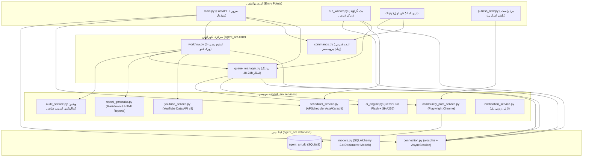
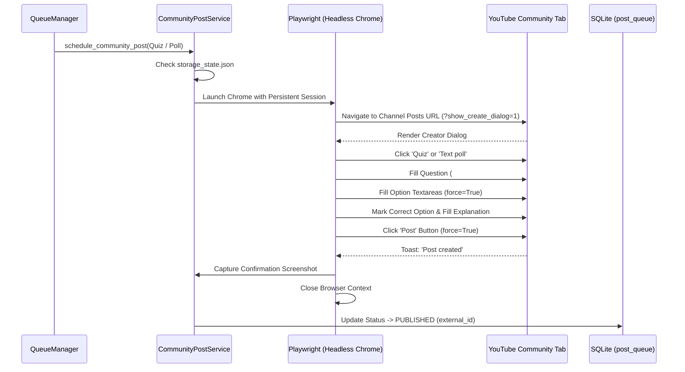

# 🔍 ایجنٹ اے ایم (Agent AM) کا جامع ابتدائی آڈٹ اور پروڈکشن بیس لائن رپورٹ
**منصوبہ:** Agent AM — The Bayaan YouTube Growth & Content Management System  
**چینل:** The Bayaan (`@thebayaanurdu` | چینل آئی ڈی: `UCcf-vu1rx2g9gPHdPwrPvYQ`)  
**مقام و ماحول:** Windows 10/11, Python 3.11.9, SQLite (`agent_am.db`), FastAPI, APScheduler, Playwright (Headless Chrome)  
**ٹائم زون:** پاکستان معیاری وقت (`Asia/Karachi` - PST)  
**آڈٹ کی تاریخ:** 2026-10-16  
**آڈٹ کی کیفیت:** مکمل تصدیق شدہ (Phase Zero Baseline Audit)

---

## 1. ایگزیکٹو خلاصہ اور پروڈکشن اسٹیٹس (Executive Summary)

ایجنٹ اے ایم (Agent AM) اس وقت یوٹیوب چینل **The Bayaan** کے لیے ایک مکمل فعال اور متحرک پروڈکشن سسٹم ہے۔ ابتدائی آڈٹ کے مطابق سسٹم کے بنیادی اجزاء (ڈیٹا بیس، اے آئی کنٹینٹ جنریٹر، یوٹیوب ڈیٹا اے پی آئی، پلے رائٹ ہیڈ لیس براؤزر، ایشیا/کراچی شیڈولر، لوکل ویب ڈیش بورڈ، اردو سی ایل آئی، اور ونڈوز آٹو اسٹارٹ) نہ صرف موجود ہیں بلکہ لائیو کام کر رہے ہیں۔ 

**ثبوت برائے لائیو کارکردگی:**
- 16 اکتوبر 2026ء کو صبح 07:16 بجے (PST) یوٹیوب کمیونٹی ٹیب پر بحیرہ احمر اور فرعون کے انجام کا کوئز لائیو شائع ہوا اور تصدیقی اسکرین شاٹ محفوظ ہے۔
- تمام 10/10 خودکار یونٹ و انضمامی ٹیسٹس (`pytest`) کامیابی سے پاس ہو رہے ہیں۔
- پروڈکشن پالیسی کے تحت موجودہ سسٹم کے کسی بھی چلتے ہوئے جزو، شیڈول (شام 6:30 کوئز، رات 8:15 پول) یا فائل میں بغیر تحریری منظوری کے کوئی چھیڑ چھاڑ نہیں کی جائے گی۔

---

## 2. پائتھون انٹری پوائنٹس اور ماڈیولر انحصارات (Entry Points & Dependencies)

سسٹم میں تین بنیادی انٹری پوائنٹس اور متعدد معاون ماڈیولز موجود ہیں:

### انٹری پوائنٹس کا تفصیلی جائزہ:
1. **`main.py`:**
   - فریم ورک: FastAPI (Port 8000)
   - لائف سائیکل (`lifespan`): بوٹ ہوتے ہی `init_db()` کو کال کر کے ڈیٹا بیس ٹیبلز کی جانچ کرتا ہے اور `scheduler_service.start()` کے ذریعے پس منظر شیڈولر شروع کرتا ہے۔
   - ماؤنٹس: `/static` (CSS/JS) اور `/reports` (HTML رپورٹس)۔
2. **`run_worker.py`:**
   - ڈیش بورڈ کے بغیر پس منظر میں 24/7 چلنے والا آزاد پائتھون ڈیمن۔
   - سگنل ہینڈلنگ: `SIGINT` اور `SIGTERM` کی مدد سے باوقار شٹ ڈاؤن۔
3. **`cli.py`:**
   - انٹرایکٹو اردو ٹرمینل۔ ونڈوز پر اردو فونٹس کے لیے `sys.stdout.reconfigure(encoding="utf-8")` فعال ہے۔
   - کی ورڈز کو قدرتی اردو فقروں میں تبدیل کر کے `urdu_commands.handle_command()` کو بھیجتا ہے۔
4. **`publish_now.py`:**
   - ہنگامی یا دستی اشاعت کے لیے الگ آزمودہ اسکرپٹ جو براؤزر کوکیز کے ذریعے کمیونٹی پوسٹ مکمل کرتا ہے۔

---

## 3. ڈیٹا بیس کی ساخت اور ماڈلز (Database Schema & Models)

ڈیٹا بیس فائل `agent_am.db` لوکل روٹ ڈائرکٹری میں واقع ہے۔ اور تمام انٹرایکشنز `SQLAlchemy 2.1.4` کے اسینکرونس ڈرائیور `aiosqlite 0.22.1` کے تحت ہوتی ہیں۔

### موجودہ ٹیبلز کی تفصیل (Table Inventory):

| ٹیبل کا نام | موجودہ ریکارڈز | بنیادی کالمز | کردار اور ڈیٹا کا مواد |
| :--- | :---: | :--- | :--- |
| **`channel_config`** | 2 | `id`, `channel_name`, `channel_id`, `total_subscribers`, `total_views`, `total_videos`, `is_verified` | چینل کی تصدیقی معلومات اور لائیو شماریات (The Bayaan لائیو ریکارڈ ID 2 پر موجود ہے)۔ |
| **`audit_reports`** | 1 | `id`, `report_date`, `period_start`, `period_end`, `total_views`, `total_subscribers`, `top_performing_videos`, `summary_urdu`, `markdown_path`, `html_path` | روزانہ کا کارکردگی آڈٹ اور اردو سمری ریکارڈ۔ |
| **`video_snapshots`** | 70 | `id`, `video_id`, `title`, `published_at`, `view_count`, `like_count`, `comment_count`, `snapshot_date` | ویڈیوز کے تاریخی اسنیپ شاٹس برائے گروتھ موازنہ۔ |
| **`post_queue`** | 4 | `id`, `post_type`, `target_date`, `scheduled_time`, `question_text`, `options_json`, `correct_answer`, `explanation`, `source_reference`, `content_hash`, `status`, `external_post_id`, `retry_count` | 24 تا 48 گھنٹے کی پوسٹنگ قطار۔ 1 پوسٹ PUBLISHED ہے جبکہ 3 VALIDATED ہیں۔ `(target_date, post_type)` پر یونیک کنسٹرینٹ ہے۔ |
| **`execution_logs`** | 6 | `id`, `job_name`, `task_type`, `status`, `duration_ms`, `details_urdu`, `error_message`, `created_at` | تمام پس منظر جابز کا تفصیلی آڈٹ ٹریل۔ |
| **`system_health`** | 3 | `id`, `component`, `status`, `message_urdu`, `last_checked_at` | اجزاء (youtube_api, ai_engine, scheduler) کی لائیو حالت۔ |

### مائیگریشن اسٹریٹیجی کا جائزہ (Migration Strategy):
- **موجودہ صورتحال:** پروجیکٹ میں اس وقت کوئی مائیگریشن فریم ورک (جیسے Alembic) نصب نہیں ہے۔ ٹیبلز صرف `Base.metadata.create_all()` کے ذریعے بنتی ہیں۔
- **کمزوری:** اگر نئے کالم شامل کیے جائیں تو بغیر مائیگریشن اسکرپٹ کے موجودہ ڈیٹا محفوظ رکھنا ممکن نہیں ہوگا۔
- **سفارش برائے فیز 1:** کسی بھی نئے فیچر کے لیے صرف غیر تباہ کن (Additive) مائیگریشنز کی جائیں گی اور ہر تبدیلی سے قبل `agent_am.db` کا خودکار بیک اپ لیا جائے گا۔

---

## 4. شیڈولر کنفیگریشن اور ٹائم زون (APScheduler Configuration)

- **شیڈولر انجن:** `APScheduler 3.11.3` (`AsyncIOScheduler`)
- **ٹائم زون:** سختی سے `ZoneInfo("Asia/Karachi")` (PST) پر مقید۔
- **شیڈول شدہ جابز (Registered Jobs):**
  1. `daily_morning_audit_workflow`:
     - ٹرگر: `CronTrigger(hour=9, minute=0, timezone=settings.tz)` (روزانہ صبح 9:00 بجے)
     - پیرامیٹرز: `misfire_grace_time=3600`, `coalesce=True` (اگر سسٹم بند رہا ہو تو آن ہونے پر 1 گھنٹے کے اندر مسڈ رن کو ریکور کرتا ہے)۔
  2. `periodic_queue_replenish`:
     - ٹرگر: `IntervalTrigger(hours=2, timezone=settings.tz)` (ہر 2 گھنٹے بعد)
     - کام: رولنگ 48 گھنٹے کی قطار میں کوئز اور پول کی موجودگی کی تصدیق اور کمی ہونے پر تیاری۔
- **پوسٹنگ ونڈو:**
  - کوئز: روزانہ شام **6:30 PM PST**
  - پول: روزانہ رات **8:15 PM PST**
- **مشاہدہ:** پوسٹس فی الحال `post_queue` میں ٹارگٹ ٹائم کے ساتھ محفوظ ہوتی ہیں۔ اشاعت کے عمل کو خودکار ٹرگر سے جوڑنا مزید مستحکم کیا جانا مطلوب ہے۔

---

## 5. یوٹیوب ڈیٹا اے پی آئی بمقابلہ اینالیٹکس اے پی آئی (YouTube API Integration)

### 1. YouTube Data API v3 (فعال اور مصدقہ):
- اے پی آئی کی (`YOUTUBE_API_KEY`) مصدقہ ہے اور براہِ راست لائیو ڈیٹا لاتی ہے۔
- استعمال شدہ اینڈپوائنٹس:
  - `GET /youtube/v3/channels`: چینل کے کل سبسکرائبرز (21)، ویوز (4,566)، ویڈیوز (9)، اور اپلوڈ پلے لسٹ آئی ڈی۔
  - `GET /youtube/v3/playlistItems`: تازہ ترین ویڈیوز کی لسٹ۔
  - `GET /youtube/v3/videos`: ہر ویڈیو کے ویوز، لائیکس، کمنٹس، اور دورانیہ۔
  - `GET /youtube/v3/search`: چینل تلاش برائے ویریفیکیشن۔

### 2. YouTube Analytics API (غیر فعال / درکار توثیق):
- یوٹیوب اینالیٹکس اے پی آئی (واچ ٹائم، اوسط دورانیہ، امپریشنز، سی ٹی آر، سامعین کی جغرافیائی تقسیم) کے لیے صرف اے پی آئی کی کافی نہیں ہوتی بلکہ **OAuth2 یوزر ٹوکن** درکار ہوتا ہے۔
- سسٹم میں `YOUTUBE_CLIENT_SECRET_FILE` اور `YOUTUBE_TOKEN_FILE` کے متغیرات موجود ہیں لیکن گوگل کلاؤڈ کنسول سے OAuth2 اسکوپ `https://www.googleapis.com/auth/yt-analytics.readonly` کی تاحال توثیق نہیں ہوئی۔
- **پالیسی:** جب تک صارف خود OAuth2 فراہم نہ کرے، سسٹم گمراہ کن اندازے یا فرضی ڈیٹا تیار نہیں کرے گا۔

---

## 6. پلے رائٹ کمیونٹی پبلشنگ اور سیشن مینجمنٹ (Playwright Publishing Workflow)

یوٹیوب کی سرکاری API کمیونٹی ٹیب پر کوئز یا ٹیکسٹ پول شائع کرنے کی اجازت نہیں دیتی۔ اس لیے ایجنٹ اے ایم نے تصدیق شدہ براؤزر آٹومیشن تیار کی ہے:

- **سیشن فائل:** `browser_session/storage_state.json` (14.3 KB)، جو صارف کے گوگل اکاؤنٹ کی کوکیز بحفاظت محفوظ رکھتی ہے۔
- **اینٹی ڈیٹیکشن:** `channel="chrome"`, `--disable-blink-features=AutomationControlled`, `--no-sandbox`۔
- **فلٹنگ اوورلے بائی پاس:** یوٹیوب کے فلوٹنگ ڈیو اوورلیز کو بائی پاس کرنے کے لیے تمام فیلڈز اور بٹنز میں `force=True` کا استعمال کامیابی سے نافذ ہے۔
- **ثبوت:** `reports/quiz_posted_live.png` پر لائیو اشاعت مکمل طور پر ریکارڈ ہے۔

---

## 7. ڈیش بورڈ، ٹیمپلیٹس اور سی ایل آئی کمانڈز (Dashboard & CLI)

### 1. ویب ڈیش بورڈ (FastAPI):
- **روٹ:** `GET http://localhost:8000/`
- **خصوصیات:**
  - چینل سبسکرائبرز، ویوز، اور اپلوڈز کے لائیو کارڈز۔
  - فوری ایکشن بٹنز برائے اردو کمانڈز۔
  - لائیو انٹرایکٹو کنسول۔
  - رولنگ 48 گھنٹے کی پوسٹنگ قطار کی بصری لسٹ۔
  - سابقہ رپورٹس کے لنکس۔
- **اینڈپوائنٹس:**
  - `POST /api/command`: اردو کمانڈ پروسیسنگ۔
  - `GET /api/queue`: قطار کی لسٹ۔
  - `POST /api/audit`: دستی آڈٹ چلانا۔
  - `GET /api/health`: سسٹم کی لائیو صحت۔

### 2. اردو کمانڈ لائن (CLI):
- فائل: `cli.py`
- سپورٹڈ کمانڈز:
  1. `روزانہ آڈٹ شروع کریں` / `audit`
  2. `آج کی رپورٹ دکھائیں` / `report`
  3. `اگلے دو دن کی پوسٹس دکھائیں` / `queue`
  4. `شیڈول شدہ پوسٹس کی تصدیق کریں` / `verify`
  5. `ناکام کاموں کی تفصیل دکھائیں` / `failed`
  6. `ایجنٹ کا سسٹم اسٹیٹس دکھائیں` / `status`
  7. `نئی کوئز پوسٹ تیار کریں` / `quiz`
  8. `نیا ٹیکسٹ پول تیار کریں` / `poll`

---

## 8. ونڈوز پس منظر عمل اور آٹو اسٹارٹ مینجمنٹ (Windows Background Integration)

سسٹم صارف کے کمپیوٹر پر خاموشی سے چلنے کے لیے مکمل ترتیب پا چکا ہے:
1. **`start_agent.bat`:** ورچوئل ماحول چالو کر کے `main.py` کو چلاتا ہے اور آؤٹ پٹ `logs/agent_runner.log` میں ری ڈائریکٹ کرتا ہے۔
2. **`start_agent_hidden.vbs`:** ونڈوز اسکرپٹ ہوسٹ کے ذریعے بیچ فائل کو `WindowStyle=0` (مخفی موڈ) میں چلاتا ہے تاکہ کوئی کالی اسکرین نہ کھلے۔
3. **`stop_agent.bat`:** چلتے ہوئے پائتھون پروسیسز کو محفوظ طریقے سے تلاش کر کے بند کرتا ہے۔
4. **`AgentAM.lnk` شارٹ کٹ:** صارف کے ونڈوز اسٹارٹ اپ فولڈر (`AppData\Roaming\Microsoft\Windows\Start Menu\Programs\Startup`) میں نصب ہے، جس سے کمپیوٹر ری اسٹارٹ ہونے پر ایجنٹ خودکار بحال ہو جاتا ہے۔

---

## 9. انسٹال شدہ پیکیجز اور اے آئی ایس ڈی کے (Installed Packages & AI SDK)

### پیکیج ورژنز کا جائزہ:
- پائتھون ورژن: `3.11.9`
- اہم لائبریریز:
  - `fastapi==0.143.2`
  - `uvicorn==0.54.0`
  - `SQLAlchemy==2.1.4`
  - `aiosqlite==0.22.1`
  - `APScheduler==3.11.3`
  - `playwright==1.64.0`
  - `httpx==0.28.1`
  - `pydantic==2.14.1`
  - `pydantic-settings==2.16.0`
  - `pytest==9.1.1`
  - `pytest-asyncio==1.4.0`

### اے آئی کنفیگریشن:
- فراہم کنندہ: Google Gemini (`gemini-3.8-flash`)
- طریقہ کار: براہِ راست آفیشل REST اینڈپوائنٹ کال بذریعہ `httpx.AsyncClient` مع سخت JSON موڈ۔
- ڈپلیکیشن پروٹیکشن: `ai_engine.compute_content_hash(question, options)` سوال اور ترتیب شدہ آپشنز کا SHA-256 ہیش بناتا ہے۔
- فال بیک میکانزم: اگر انٹرنیٹ منقطع ہو یا API کی غیر فعال ہو جائے، تو سسٹم کریش نہیں ہوتا بلکہ پہلے سے توثیق شدہ کلاسک اسلامی کتب (تاریخ طبری، البدایہ والنہایہ) کے ذخیرے سے سوال چن لیتا ہے۔

---

## 10. موجودہ کمزوریوں اور خطرات کا رجسٹر (Risk Register & Weakness Analysis)

| نمبر | خطرہ / کمزوری (Risk / Weakness) | شدت (Severity) | اثر (Impact) | انسدادی تدبیر (Proposed Mitigation) |
| :---: | :--- | :---: | :--- | :--- |
| **R1** | **ڈیٹا بیس بیک اپ کی عدم موجودگی:** `agent_am.db` کا کوئی خودکار وقتی اسنیپ شاٹ یا بیک اپ نہیں لیا جاتا۔ | **زیادہ (High)** | سسٹم کریش یا ڈسک خرابی پر تاریخی ریکارڈز ضائع ہو سکتے ہیں۔ | فیز 1 میں ہر کام سے پہلے خودکار روٹیشنل SQLite بیک اپ سروس کا اضافہ۔ |
| **R2** | **سخت SHA-256 ہیش پر انحصار:** اگر سوال کے الفاظ تھوڑے بدل دیے جائیں لیکن مفہوم ایک ہی ہو تو SHA-256 اسے نہیں پکڑ پاتا۔ | **درمیانی (Medium)** | چینل پر ملتے جلتے سوالات کی تکرار ہو سکتی ہے۔ | فیز 3 میں نارملائزڈ ٹیکسٹ فنگر پرنٹنگ اور سیمینٹک چیکس کا اضافہ۔ |
| **R3** | **یوٹیوب اینالیٹکس OAuth2 کا فقدان:** تفصیلی اینالیٹکس (واچ ٹائم، سی ٹی آر) کے بغیر ترقیاتی تجزیہ محدود ہے۔ | **درمیانی (Medium)** | آڈٹ رپورٹ صرف پبلک ڈیٹا تک محدود رہتی ہے۔ | فیز 2 میں واضح نشاندہی کی جائے گی کہ کون سا ڈیٹا لائیو ہے اور کون سا درکار۔ |
| **R4** | **باقاعدہ اپروول اسٹیٹ مشین کا فقدان:** فی الوقت پبلشنگ کمانڈ دینے پر براہ راست پبلش ہو جاتی ہے، کوئی رسمی Pending/Approved/Rejected ریکارڈ نہیں بنتا۔ | **زیادہ (High)** | غیر ارادی یا بغیر توثیق شدہ پبلشنگ کا خطرہ۔ | فیز 1 اور 6 میں کڑا رول بیسڈ اپروول ورک فلو نافذ کیا جائے گا۔ |
| **R5** | **مائیگریشن ٹول کی عدم موجودگی:** ڈیٹا بیس میں نئے کالمز کے اضافے کے لیے کوئی Alembic سکرپٹ موجود نہیں۔ | **زیادہ (High)** | فیوچر اپ گریڈز میں ڈیٹا کے کرپٹ ہونے کا اندیشہ۔ | محفوظ، اڈیٹیو مائیگریشنز اور بیک اپ پروسیجر وضع کیا جائے گا۔ |

---

## 11. رول بیک اور بحالی کا منصوبہ (Rollback & Restoration Plan)

کسی بھی نئے ماڈیول کو فعال کرنے سے پہلے درج ذیل پروٹوکول پر عمل کیا جائے گا:
1. **ڈیٹا بیس کی نقل:** ہر تبدیلی سے قبل `agent_am.db` کی کاپی `backups/agent_am_pre_upgrade.db` میں رکھی جائے گی۔
2. **غیر تباہ کن تبدیلیاں:** موجودہ ماڈیولز کو اوور رائٹ نہیں کیا جائے گا بلکہ نئے فیچرز کو نئے آزاد ماڈیولز کے طور پر شامل کیا جائے گا۔
3. **فوری بحالی (Rollback Command):** اگر نیا ماڈیول فیل ہو جائے تو پرانے ورژن کو ایک ہی کمانڈ سے بحال کیا جا سکے گا بغیر یوٹیوب سیشن یا شیڈول کو متاثر کیے۔
